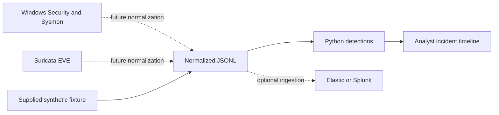

# SOC incident lab

Detection engineering and incident triage portfolio by Cristobal Samano Osuna. Developed with AI assistance. Supplied events are synthetic, not evidence of a production incident. This repository implements an offline detector; live Windows, Suricata and SIEM integration remains an extension to execute and document.

## Reproduce

Python 3.10+; no dependencies. From this directory:

```shell
python detect.py events.jsonl
python -m unittest -v
```

Expected: four alerts, AUTH-001, AUTH-002, PROC-001 and NET-001. Command lines in fixtures are data and are never executed.

## Architecture



## Contract and detection logic

Records require ISO 8601 timestamps with timezone and `kind`. Authentication records need `src_ip` and `user`; process records use `image` and `command_line`; IDS records use `signature_id`. Only trusted, normalized data is supported. Raw EVTX/EVE are not directly accepted.

| Rule | Trigger | ATT&CK hypothesis | Benign explanation |
|---|---|---|---|
| AUTH-001 | Five source/user failures in five minutes | T1110 | Stale password |
| AUTH-002 | Success after threshold | T1078 | User remembers password |
| PROC-001 | PowerShell -enc/-EncodedCommand | T1059.001 | Approved automation |
| NET-001 | Lab SID 1000001 | None inferred | Deliberate marker request |

## Synthetic incident report

12:01:20 UTC: authentication threshold reached. 12:02:00: same source/user succeeds. 12:02:10: encoded PowerShell on win-lab. 12:02:20: lab network marker observed. These observations justify investigation; they do not establish compromise. The network marker has no user attribution.

Validate account ownership and approved maintenance; inspect parent process and command content as text; correlate host identity, addresses and clocks. Preserve original logs and hashes. If malicious activity is confirmed, isolate the lab host, revoke sessions and rotate credentials before recovery. Record root cause, scope, corrective controls and validation. No automated containment is implemented.

## Real-lab extension

In isolated VMs, collect Security 4624/4625 and Sysmon event 1. Normalize to this schema. Validate `lab.rules` with the installed Suricata version, then make a harmless request to `/portfolio-lab-marker` on a local HTTP server. Import normalized events into a dedicated Elastic/Splunk index. Capture versions, dashboards and real evidence only after executing this extension.

## Limitations

Batch-only in-memory state, fixed thresholds, no deduplication, exact flag matching and no cross-host correlation. Repeated failures after the fifth do not produce another threshold alert until the window falls below the threshold. Add schema validation, distributed spray detection and benign datasets to measure precision/recall. A rule match is not proof of compromise. Live integration and Suricata rule execution are not claimed as tested here.

## Entrevue — français

Explique le seuil, les faux positifs, la chronologie et la différence entre indice et preuve. Rejoue les scénarios, change le seuil et ajoute un test avant de présenter ce travail comme une compétence maîtrisée. Les exemples ne viennent d'aucun client.
